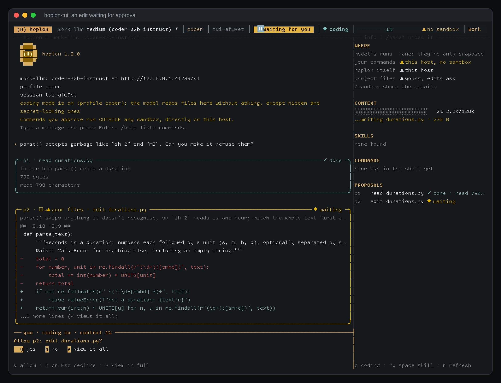

# Hoplon

A coding agent for power users who want full control over everything it does.

**Zero dependencies.** The core is a single Python file, about 6,300 lines, using only the standard
library. There's nothing to `pip install` and nothing pulled in. Your own agent can audit it in
minutes before you run it. All it needs is Python 3.10 or newer. The terminal UI is optional and
adds tmux 3.2 or newer.

- **Zero defaults.** No endpoint is built in, so nothing is sent anywhere until you name one and
  approve it.
- **You run the commands.** The model proposes, and you decide. The exceptions are opt-in: an offline
  container on a throwaway copy of your project, and the commands of a command set you blessed that
  run without asking.
- **"Read-only" is a claim you check.** A command set marks each command `read` or `write`, and says where
  it connects over the network. Reads that use no network run live without asking. hoplon can't tell what a
  program does, so both are the set author's word: bless a set only when you know its read commands only
  look and connect only where they say. hoplon checks the program file, not its behavior.
- **One way out.** No web access and no rendered links or images. With no command set on, the model
  reaches only the endpoint you approved. A command set you enable adds what its commands reach: each
  one declares it (`none`, named destinations, or `any`), the blessing screen shows it, and a command that
  uses the network asks every time unless you let it run without asking.
- **Secrets stay put.** Files that look like secrets ask first and are hidden from the sandbox, and
  keys are masked in output.
- **Your project can't configure the agent.** Nothing is read from the folder you work in, and every
  endpoint, profile and skill needs your approval.
- **What you approve is what happens.** An approval is tied to the exact change you saw.
- **Autonomy on a leash.** Work sessions run in a private copy, and you merge the result yourself.



Full threat model: [SECURITY.md](SECURITY.md). Design choices and known limits:
[DECISIONS.md](DECISIONS.md).

## Quick start

From a clone of this repository:

```bash
mkdir -p ~/.local/bin                       # any directory on your PATH will do
ln -s "$PWD/hoplon" "$PWD/tui/hoplon-tui" ~/.local/bin/
export HOPLON_API_KEY=...                    # your key; the endpoint names the variable, never the key
hoplon --new-endpoint                        # asks for the server, key variable, model and context size
hoplon --bless ~/.config/hoplon/endpoints/work-llm.json   # shows URL, model, key source; asks you to confirm
hoplon -e work-llm "what does 'set -euo pipefail' do?"
```

`--new-endpoint` asks for a name (`work-llm` above), your server's OpenAI-compatible address (usually
ending in `/v1`), the environment variable that holds your API key (its name, never the key), the model
(from the server's own list, if you let it ask the server: it asks first, since that sends your key) and the model's context size, and optionally which
models are `low`, `medium` and `high` ([model aliases](docs/endpoints-and-profiles.md#model-aliases)).
It writes the file with private permissions and stops: blessing it is your step. You can also write the
file by hand:

```json
{
  "name": "work-llm",
  "base_url": "YOUR-SERVER-ADDRESS/v1",
  "model": "YOUR-MODEL-NAME",
  "key_env": "HOPLON_API_KEY",
  "context_limit": 128000
}
```

To use the example persona, which grants coding mode and uses a bundled skill, add
`"skill_dirs": ["/path/to/hoplon/skills"]` to `~/.config/hoplon/config.json` ([Configuration](docs/configuration.md)),
then bless both and start it in a project directory (coding mode is refused in your home directory):

```bash
hoplon --bless profiles/coder.json           # a persona: shows its text, endpoint, skills, coding grant
hoplon --bless skills/bash                   # the skill it uses
cd ~/src/some-project
hoplon -e work-llm -p coder                  # REPL: a line with only '..' sends; :help for commands
hoplon-tui -e work-llm -p coder              # the same in tmux panes, beside your shell (needs tmux)
```

To let the model run its own builds and tests in an offline container, on this host's OS or an image, add
`"sandbox": {}` to the profile: see [Sandboxed coding](docs/hoplon-tui.md#sandboxed-coding).

## Documentation

- [Endpoints and profiles](docs/endpoints-and-profiles.md): where prompts go, personas, coding mode,
  approved files, command-line use
- [Configuration](docs/configuration.md): `~/.config/hoplon`, settings, the files in this repository,
  the live test
- [hoplon-tui](docs/hoplon-tui.md): the terminal UI, another host over ssh, remote mode, the file tree
- [Work sessions](docs/work-sessions.md): the model plans, codes, tests and commits on a branch of its own
- [Benchmark tasks](bench/README.md): fixed work-session tasks, to check a prompt or model change against real runs
- [Sandbox](docs/sandbox.md): running hoplon in a container, and the model's own sandboxed builds and tests
- [Command sets and scoped commands](docs/commands.md): narrow commands you approve once
- [Hooks](docs/hooks.md): your own programs at fixed points ([HOOKS.md](HOOKS.md) has the design)
- [JSON protocol](docs/json-protocol.md): driving hoplon from a wrapper

## License

MIT. See [LICENSE](LICENSE).
