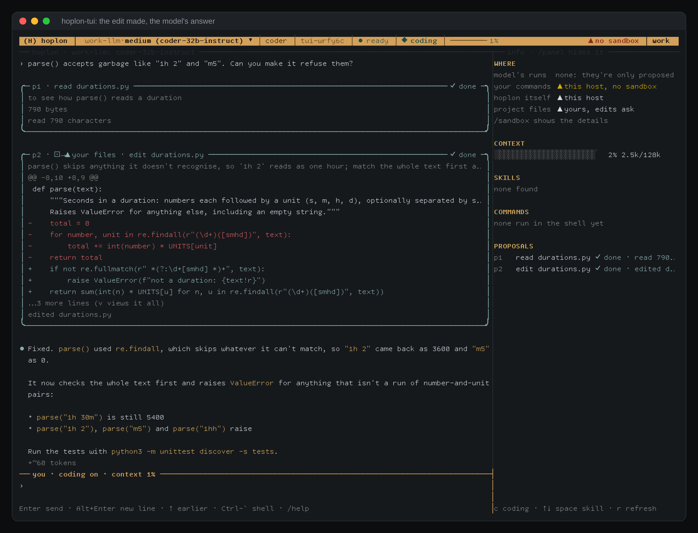
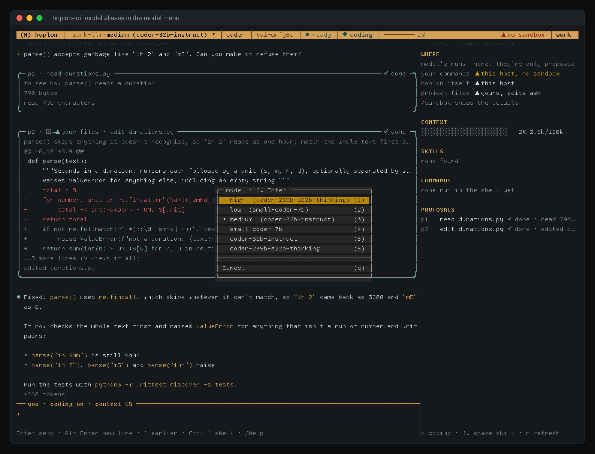

# hoplon-tui

hoplon-tui runs hoplon in tmux panes beside your own shell: the conversation, an info panel, and the shell (Ctrl-` shows or hides it). `/help` lists its commands.



## Sessions

Every conversation is kept in a saved session, so it can be picked up again. `-S NAME` starts or
resumes the one you name; without it, hoplon-tui makes up a new name such as `tui-k7f3qa`. When you
quit, it prints the command that resumes it:

```
Resume this conversation: hoplon-tui -S tui-k7f3qa
```

It prints that only once something was said, so there is a session to resume. `hoplon --list-sessions`
lists them all.

With `--remote` it works the same way, and the session is kept here, on your machine, not on the host: hoplon
there gets the saved conversation when it starts and sends every save back, and hoplon-tui writes it here. The
resume command it prints includes `--remote`. A remote session is marked with the host and user it ran as, and is
only ever sent back to that host as that user: hoplon-tui refuses to resume a local session on a host, or one host's
session on another, and plain `hoplon -S` refuses to resume a remote one here, so a conversation never reaches a
machine it didn't come from. `hoplon --list-sessions` shows where each remote one ran.

`--no-save` keeps nothing of the conversation on disk: no session is written, and nothing is printed
to resume. `{"save_sessions": false}` in `~/.config/hoplon/tui.json` makes that the default; `-S NAME`
still saves to the session you name.

## Sandboxed coding

`--coding` alone lets the model read and edit the project, but every build or test is only proposed: you
run it. To let the model run them itself, in a container, give it a profile with a sandbox:

You need rootless podman. No image: by default the runs use this host's own OS, with `/usr` and `/etc`
read-only, so the tools you have installed are the ones the tests use.

1. **A profile with a sandbox**, in `~/.config/hoplon/profiles/coder-box.json`:

   ```json
   {
     "name": "coder-box",
     "endpoint": "work-llm",
     "coding": true,
     "sandbox": {}
   }
   ```

   `"image"` runs in a container image instead, for tools the host doesn't have; the runs are offline and
   never pull, so pull or build it first. `timeout`, `memory`, `pids` and `network` are optional; see
   [Sandboxed runs](sandbox.md#sandboxed-runs).
2. **Bless it:** `hoplon --bless ~/.config/hoplon/profiles/coder-box.json`. It shows the coding grant and
   what the sandbox runs on.
3. **Start it in the project's directory**, not your home directory (the sandbox is refused there):

   ```bash
   cd ~/src/myproject
   hoplon-tui -p coder-box
   ```

The info panel's WHERE section then says `model's runs ⊡ sandboxed · offline` with `this host's OS` (or the image), and tmux's
status line says `⊡ model's runs sandboxed`. If it says `can't run:` instead, the rest of the line says
why (no podman, or a directory where coding mode is refused); a missing image is reported on the first run.
`/sandbox` shows what it runs on, the network and the limits.

The model's runs then happen on a throwaway copy of the project, offline and without files that look
like secrets, and don't ask: you see each command, its exit code and output. Edits to your files still
ask. `/network on` gives the sandbox the network for this session, and then every run asks. `/stop` (or
Ctrl-C on an empty input) stops a run. Commands the model proposes for your shell still run there, live,
and ask as always. `/work` goes one step further: a work session changes a copy on its own branch, and you
review one diff at the end.


In hoplon-tui's shell pane, connect with `hoplon-ssh` instead of `ssh`:

```
hoplon-ssh -p 2222 me@login1.cluster      # ssh options as usual; no remote command
```

It is your own ssh (config, keys, agent) starting bash on that host with hoplon-tui's prompt hook,
so hoplon-tui follows each command there as it does here: `/run` sends a proposed command to that
host (the question says so, in red), `/share N` and the info panel show which host a command ran
on, and nothing is installed there. The session has a key of its own that never appears on a
command line or on screen; see SECURITY.md, section 7. Plain `ssh` still works, but hoplon-tui
can't follow it, and `/run` refuses while it runs.

## Remote mode

```
hoplon-tui --remote me@devbox --dir /srv/project                    # hoplon runs on devbox, in that directory
hoplon-tui --remote me@devbox --dir /srv/project --as svc           # ... as another user, through sudo -n
hoplon-tui --remote me@devbox -e work -p coder -- -J me@bastion     # a bastion; more ssh options after --
```

The screen, your endpoint's API key and your blessed configuration stay on your machine. hoplon runs on the
host, in PATH, as you or as `--as USER` (which needs `sudo -n -u USER` to work without a password there; the
launcher checks). The shell pane is a followed session on the same host, as the same user, in the same directory,
and says `disconnected from HOST` and offers to reconnect if it drops. Prefer ProxyJump (`-J`, or `ProxyJump` in
`~/.ssh/config`) to agent forwarding for a bastion: the connection never offers your agent to the host, and hoplon-tui
passes `-a` to ssh so a config file can't either.

What happens, before tmux starts (so a password or second factor is asked for in your own terminal):

1. `hoplon --remote-config` resolves `-e` and `-p` exactly as a normal start would (default endpoint and profile,
   blessing checks, a changed file is refused) and prints the endpoint and profile *without* `key_env`, `key_file`,
   `proxy`, `headers` or `ca_bundle`. The skills and command sets in use (the profile's, or `default_skills` and
   `default_commands`, plus `-k`) go with their files, if they are blessed here; one that isn't is left out, with a
   message. On the host they are checked against the hashes blessed here, the command sets' programs are looked for there
   (a command whose program is missing there is left out, as locally), and nothing blessed only on the host can be
   used. So the Slurm command set's commands run on the cluster.
2. An ssh master connection (`ssh -M -S STATE/cm -fN`, then the host's checks: Python 3.10 or newer as the target user,
   `sudo -n` for `--as`, the directory) whose control socket lives in hoplon-tui's private 0700 state directory.
3. `tui/keyproxy.py` starts here on a Unix socket, with a random token on its stdin.
4. `ssh -O forward -R 127.0.0.1:0:STATE/kp.sock` opens a loopback port on the host that leads to that proxy.
5. The conversation pane runs hoplon there over the same connection: a short Python program reads hoplon's own source
   from stdin (it is too big for a command line), runs it, and hoplon then reads a config line (the endpoint, whose
   `base_url` is that loopback port, the profile and the token) and the usual protocol. Nothing is installed or
   left on the host, and it is always the same hoplon version as yours. What is sent is `hoplon --bundle`; the
   program hashes it as it arrives, and the conversation ends unless hoplon there names that same sha256.

The proxy accepts only `GET /v1/models` and `POST /v1/chat/completions` with the token, adds the key and the
endpoint's headers, and sends the request on through the endpoint's own TLS and proxy settings. On exit the proxy,
the forward and the ssh connection are closed; detaching tmux keeps the launcher running to hold them, so Ctrl-C there
ends the session.

You can see where it runs: the banner says `hoplon runs ON host AS user in dir` and the info panel's WHERE section
says `ON host AS user in dir` (both red as root), the header names the host, and the banner gives the audit log's path on the host (`hello`'s `audit`). The sessions,
audit log and `~/.config/hoplon` that hoplon uses are those of the user it runs as on the host; its endpoint is not
blessed there, because the blessing happened here. Test it against a SLES container with `tests/remote_sshd.sh test`, or against a real host of yours with
`HOPLON_TEST_REMOTE_HOST=me@devbox python3 -m unittest tests.test_remote.TestRealHost` (a turn, then a sandboxed run and a
stopped one if the host has rootless podman and `HOPLON_TEST_REMOTE_IMAGE`, default `docker.io/library/alpine:3`, pulled; it works in a
`mktemp -d` directory there and removes it).

Limits: the host's login shell must be POSIX-like, its sshd must allow TCP forwarding (`AllowTcpForwarding`), and
`python3`, `python3.13` ... `python3.10` is searched in that order for 3.10 or newer (SLES: `zypper install python311`).
Another user of that host can reach the forwarded port, which is why the token matters (SECURITY.md).

## Files that look like secrets

In coding mode, reading a file that looks like it holds secrets asks first. If it doesn't (code
like `token = token.strip()` can look like a password), answer `a` (not secrets) instead of `y`: hoplon
remembers that exact text in `~/.config/hoplon/not-secret.json` and won't ask about it again, skip
it in searches or hide it from sandboxed runs, until the file changes. A file holding the endpoint's
key always asks. Remove an entry from that file, or the file, to be asked again.

You don't have to wait for the model to read a file. In the files pane, a file hoplon thinks holds
secrets is marked ⚠; `s` on it shows it in the pager, then asks whether it holds no real secrets. Say
`y` and hoplon marks the text you saw, refusing if the file changed in between. That is the way to let
a project's test fixtures, full of fake keys, into the sandbox. A name that is a secret by definition
(`.env`, `id_rsa`, `*.key`) can't be marked. A sandboxed run's card says how many files your list let
through.

## The right column

The info panel sits on the right, and `/panel` shows or hides that column. A command set's pane (`/commands NAME pane`)
opens there too, as a tab: with two or more, the column's top border shows them, the one on screen in bronze. `/tab`
goes to the next tab, `/tab NAME` to that one, and a click on the border opens a menu of them. A tab that isn't on
screen keeps running, with its scrollback. `/commands NAME pane` on the tab that is on screen takes it out of the
column (it keeps running; the same command brings it back).

## File tree

`/files` shows or hides a file tree of the working directory on the left (`hoplon-tui --files` starts
with it shown, as does a profile whose `layout` says `"files": "shown"`; see
[endpoints-and-profiles.md](endpoints-and-profiles.md)). Move with the arrow keys; Right or Enter opens a directory and Left closes it; `.`
shows or hides hidden files and `r` refreshes. On a file, Enter views it in the pager, `a` attaches it
to your next message, `i` puts its path in the input box and, on a file marked `⚠`, `s` marks it as
holding no secrets once you've seen it ([above](#files-that-look-like-secrets)). A `⚠` marks a file hoplon thinks holds
secrets, `⚿` one the model would have to ask about first, and `↪` a symlink, which is not followed.

Browsing sends nothing to the model. Listings and files come through hoplon, which applies its usual
checks and masks secrets it recognises. `a` opens the file in your editor first, like shell context:
what you save goes with your next message, and nothing does if you save an empty file.

**Viewing.** A file, a whole proposal (`v`) and the raw view open in hoplon-tui's own pager, in a popup: Esc or `q`
closes it, the arrows, PgUp/PgDn and the wheel scroll, `/` searches and `n`/`N` move between matches. To use
another, set `HOPLON_TUI_PAGER` (for example `HOPLON_TUI_PAGER=less`).

## Sending output from the shell pane

`hoplon-share` sends output from the shell pane to the conversation, to go with your next message.
Pipe into it, or give it a command to run so the exit code goes too:

```bash
make test 2>&1 | hoplon-share --note "the flaky one"
hoplon-share --note "before the fix" make test
```

You still see the output as it runs. Nothing starts a turn: each share waits, with its note, so you
can collect several and then ask about them all ("what do these have in common?"). `/shared` lists
what is waiting, `/shared drop N` takes one back and `/shared clear` takes them all back; the info
panel shows how many are waiting. `-r` opens the output in your editor before it is sent. Long output
is cut to its start and end, and hoplon masks the secrets it recognises, as for `/share`. Not yet in
remote mode, where the shell pane is on the other host.

## Features

hoplon-tui's `/model`, `/copy`, `/decline`, `/raw`, `/system`, `/files`, `/sandbox`, `/edits`, `/commands` and `/work`, and the `hoplon-ssh` handshake, are
features, each in its own module under `tui/features/`. To switch some off, list them in
`~/.config/hoplon/tui.json` (`$XDG_CONFIG_HOME/hoplon/tui.json`):

```json
{"disable": ["copy", "model"]}
```

or set `HOPLON_TUI_DISABLE=copy,model` for one run. Names are `model`, `copy`, `decline`, `raw`,
`ssh`, `files`, `sandbox`, `edits`, `commands` (without it, no command set's pane can connect), `work`, `fixtures`, `leftovers`, `alerts` (without it, no bell) and `shared` (without it, hoplon-share sends nothing). A disabled feature has no command, help line or menu item, and hoplon-tui's socket
refuses its requests. Without `ssh`, a hoplon-ssh session isn't followed. No file means
everything is on; a file that can't be read is ignored, with a note in the conversation.

When something waits for your decision, hoplon-tui rings the terminal bell once and the header
shows `⏸ waiting for you` until you answer, so you notice from another window. Most terminals
turn the bell into an alert or a highlighted window. `/alerts off` silences the bell for this run
(`/alerts on` brings it back); `{"alerts": false}` in `~/.config/hoplon/tui.json` keeps it off from
the start, and `HOPLON_TUI_ALERTS=off` or `on` overrides that for one run. The header shows
`⏸ waiting for you` either way. (hoplon's notify hook doesn't run under hoplon-tui.)

The header, a bronze band along the top, shows the endpoint and model (click the model, `▾`, to pick another, as
`/model` does), the profile and session, what hoplon is doing (`● ready`, `● working`, `⏸ waiting
for you`), coding mode or chat, a work session's item, and a context gauge that turns from green to black at 70%
and red at 90%. On its right are the sandbox and the host, and tmux's keys when the terminal is
wide enough.



While hoplon replies, the prompt pane's bottom line (and the info panel) says what is arriving:
`thinking · ~3,200 tokens`, `writing game/index.html · 18 KB` as a tool call streams in, or
`replying · ~400 tokens`. When the turn ends, a quiet line under it gives what the model generated
and how fast: `+1,240 tokens · 38 tok/s · 33 s`, summed over the turn's requests and counting thinking
and tool calls. A `~` means hoplon counted streamed pieces, about a token each, because the server
reported no usage.

The colours are "bronze on iron": bronze for hoplon's badge, the focused pane and key hints; brass
for what waits on you and for anything live, outside the sandbox; patina for the sandbox and for
what ran fine; ember for errors and risks. They need a 256-colour terminal and fall back to the
basic 16 otherwise. Your terminal's own background is kept. `NO_COLOR` turns colour off, leaving
bold and dim.
